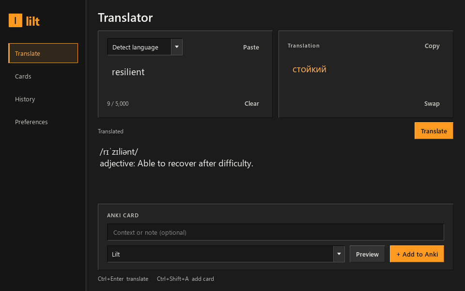

# Lilt

A small Windows desktop translator for **English ↔ Russian**, with a quick selection popup, local translation history, and shortcut-driven Anki cards. No Lilt account is needed.

The interface uses a charcoal theme, orange accents, sharp borders, and square checkboxes.



## Run

Open **`dist/Lilt/Lilt.exe`** from the packaged build. Keep the entire `dist/Lilt` folder together; the executable needs its adjacent files. Python is not required to run this package.

To run from source, use Python 3.12 or newer on Windows (tested with Python 3.14). In this project folder:

```powershell
python -m venv .venv
.\.venv\Scripts\python.exe -m pip install -r requirements.txt
.\.venv\Scripts\python.exe -m lilt
```

With the environment activated, the launch command is simply `python -m lilt`. Opening Lilt again brings its existing window forward.

## Translate while reading

1. Leave Lilt running and select a word or sentence in another application.
2. Hold **Ctrl** and tap **C** twice quickly, within about 0.6 seconds. The application must support copying the selection.
3. The quick popup opens beside your mouse cursor and translates the clipboard text. Near a screen edge it opens on the other side and stays within that monitor's work area. Press **Esc** to hide it and keep reading.

You can also copy once, then press **Ctrl+Alt+Space**, or choose **Translate clipboard** from Lilt's tray menu. The shortcut uses the current clipboard; it does not extract text from pictures or applications that prevent copying.

| Shortcut | Action |
| --- | --- |
| Ctrl+C, C | Open the quick popup and translate the copied text |
| Ctrl+Alt+Space | Translate the current clipboard |
| Ctrl+Enter | Translate the text in the active Lilt translator |
| Ctrl+Shift+A | Save the displayed source and translation as an Anki card |
| Esc | Hide the quick popup |

In the main window, paste or type text and click **Translate**. Language detection chooses between Russian and English locally; select the source language yourself for short or mixed-language passages. The other language becomes the target. You can edit the translated text before making a card. Google may also return alternatives grouped by part of speech and transliteration; these are optional and vary by word.

## Translation providers and connection drops

**Google web** is the default and needs no account or API key. It uses an unofficial Google endpoint that may change, reject requests, or become unavailable. It worked from the development machine during setup; this does not guarantee availability on every network or future date. Lilt shows connection and service errors so you can retry.

**DeepL API** is optional. Enter your own API key in **Preferences**, select DeepL, and click **Save preferences**. Lilt uses DeepL's official API, separate from its desktop application. Its live integration has not been verified without a real key. Your DeepL account's current plan and allowance apply; see [DeepL's API documentation](https://developers.deepl.com/docs) and [plan information](https://support.deepl.com/hc/en-us/articles/360021200939-DeepL-API-plans).

New translations need an internet connection. Previously saved results can be reused locally for the **same text, source-language setting, and provider**. This exact-query cache is not a general offline translation engine. **History** lets you read earlier results. **Clear history** removes both history and cached translations while keeping your cards.

## Make Anki cards

Lilt connects to Anki desktop on this computer through [AnkiConnect](https://git.sr.ht/~foosoft/anki-connect).

1. In Anki, open **Tools → Add-ons → Get Add-ons** and enter **`2055492159`** ([AnkiWeb listing](https://ankiweb.net/shared/info/2055492159)).
2. Restart Anki and leave it open with your collection loaded.
3. In Lilt's **Preferences**, click **Test connection**. If Anki asks to allow access, approve Lilt's connection. AnkiConnect listens at `127.0.0.1:8765`; no AnkiWeb account is needed for local card creation.
4. Translate something, optionally add a context sentence, and choose or type a deck name. A new deck is created when the card is sent.
5. Click **Preview**, then **Add to Anki**, or press **Ctrl+Shift+A**.

The first successful send creates a note type named **Lilt** with **Front**, **Back**, and **Context** fields. It makes one card: the source on the front, and the translation plus your context on the back. If a different note type already uses the name Lilt, rename it in Anki before retrying.

Cards are saved locally before sending. If Anki is closed or unreachable, open **Cards** later and click **Send to Anki** on a waiting card. Retry is explicit; leaving a card waiting does not automatically send it. A successful send is marked **In Anki**. Removing a local card from Lilt leaves any existing Anki note in place.

An AnkiConnect API key is only needed if you configured one in that add-on. Enter it in **Preferences** and save. The app does not require a key for the default AnkiConnect configuration.

### Export instead

In **Cards**, choose **Export for Anki** to save all local cards as a UTF-8 `.tsv` file, including cards already sent to Anki. In Anki, choose **File → Import**, select the file, and review the preview before importing:

| Export column | Import mapping |
| --- | --- |
| 1 — Front | Front |
| 2 — Back | Back |
| 3 — Context | Context |
| 4 — Deck | Deck column |

Choose the **Lilt** note type, or create a note type with those three fields first. The export includes headers for tab separation, plain text, the `lilt` tag, and the deck column. On current Anki versions these guide the import. If using another note type, map or ignore Context deliberately. Review Anki's duplicate handling when importing cards you have already sent. See the [official text import guide](https://docs.ankiweb.net/manual/importing/text-files).

## Preferences, tray, and local data

**Preferences** controls the provider, optional keys, double-copy capture, and closing to the tray. Click **Save preferences** to apply changes. By default, closing the main window leaves Lilt in the Windows system tray so the shortcuts continue working. Double-click its tray icon to reopen it; choose **Quit Lilt** from the tray menu to exit fully. Lilt does not add itself to Windows startup.

Lilt stores its database and preferences in **`%LOCALAPPDATA%\Lilt`**, normally `C:\Users\<you>\AppData\Local\Lilt`. The `lilt.sqlite3` database contains translation history, cached text, and local cards in readable form. Quit Lilt before backing up the whole folder.

Optional API keys are saved separately as `credentials.dpapi`, protected for your Windows account using [Windows DPAPI](https://learn.microsoft.com/en-us/windows/win32/api/dpapi/nf-dpapi-cryptprotectdata). They generally cannot be moved to another account or computer by copying that file; enter them again there.

Text is sent to the selected translation provider only when you click **Translate**, use its shortcut, or invoke clipboard translation. Typing alone does not send a request. A matching cached result uses no network request. Context and card contents are sent to local Anki when you add or retry a card. The global keyboard listener recognizes the capture shortcuts; it does not save a keystroke history.

## Limits and troubleshooting

- This version targets Windows and supports only Russian and English. Each translation accepts up to **5,000 characters**.
- If a selection does not copy, try copying once and using **Ctrl+Alt+Space**, or paste into the main window. Another application's reserved shortcut, elevated window, or clipboard behavior can affect global capture. The tray's **Translate clipboard** action is another fallback.
- If the detected language is wrong, select **English** or **Русский** before translating.
- If Anki cannot be reached, check that Anki is open, the add-on is installed, and Anki was restarted. Use **Test connection** and check any configured API key. Your card stays in Lilt for retry.
- Dictionary alternatives and transliteration are provider-dependent. DeepL currently supplies the translation only.
- There is no bundled offline model, pronunciation audio, OCR, or automatic context extraction in this version.

## Test and build

From the project folder, with the source environment installed:

```powershell
.\.venv\Scripts\python.exe -m unittest discover -s tests -v
```

Build the Windows folder package with:

```powershell
.\build.ps1
```

The build produces `dist/Lilt/Lilt.exe`. Run it from its folder, then check translation, popup capture, tray behavior, and your Anki connection. Automated tests exercise behavior using controlled responses; a live service check establishes availability only at the time and place it runs. DeepL requires your own key for live verification.

For a noninteractive package check that uses no network, keyboard hook, or personal Anki collection:

```powershell
Start-Process -FilePath .\dist\Lilt\Lilt.exe -ArgumentList '--self-test', "$PWD\package-check.json" -Wait
Get-Content .\package-check.json
```

Runtime license notices are included next to the executable in `THIRD_PARTY_NOTICES.md` and `licenses/`.

## Integration references

- [AnkiConnect current source and documentation](https://git.sr.ht/~foosoft/anki-connect), [original repository's move notice](https://github.com/FooSoft/anki-connect), and [version 6 API documentation snapshot](https://github.com/FooSoft/anki-connect/blob/b896b6673695ded4affd157034cf8ac52120e494/README.md).
- [DeepL official API documentation](https://developers.deepl.com/docs) and [official Python SDK](https://github.com/DeepLcom/deepl-python).
- [Google Cloud Translation's supported API](https://cloud.google.com/translate/docs) is a separate product. Lilt's default Google web integration is unofficial and does not use a Cloud account or its API key.
